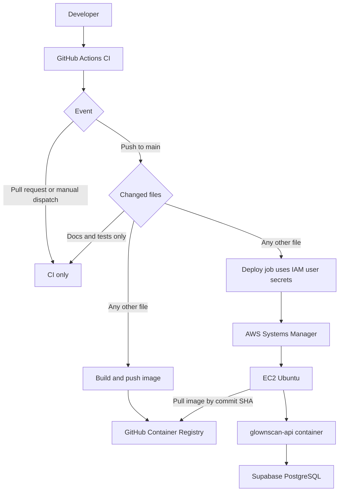

# AWS Setup 01 --- Architecture and Prerequisites

## Purpose

This document describes the current GlownScan backend deployment shape
and the prerequisites needed before setting up or troubleshooting it.

## Current architecture

The GitHub Actions deployment path uses SSM instead of opening SSH to
GitHub-hosted runners. SSH remains available for administrator
maintenance and is restricted to an approved source IP.

## Environment facts

- AWS Region: `ap-southeast-2`
- EC2 instance: `i-009ee9f9e537e232b`
- Operating system: Ubuntu 24.04
- GitHub repository: `PawPasta/glownscan_be`
- Intended deployment branch: `main`
- Container registry: GitHub Container Registry (GHCR)
- Container name: `glownscan-api`
- Host/container port: `3000`
- Host bind address: `127.0.0.1`
- Environment file: `/opt/glownscan/.env`
- Database: Supabase PostgreSQL
- Health endpoint: `/health/database`

Treat IP addresses as operational values that can change; verify them in
the EC2 Console.

## Prerequisites

- Access to the AWS account and EC2, IAM, and Systems Manager
  consoles.
- Access to the GitHub repository settings and Actions logs.
- An EC2 SSH private key stored securely on the administrator's
  computer.
- A GitHub token with the minimum required package permissions for
  GHCR, if the package is private.
- Application environment values for the NestJS API and Supabase
  connection.
- Docker installed on EC2.
- An EC2 SSM management path that reports the instance as Online.
- IAM permissions for GitHub Actions to send and inspect SSM commands.

## Application assumptions

The backend uses Node.js 22 or newer during development/build, NestJS,
npm, and TypeScript. The deployment image runs the production entry
point and receives configuration through `/opt/glownscan/.env`.

The backend reads `GLOWNSCAN_DATABASE_URL`, with `DATABASE_URL` as a
fallback. Confirm the current source code and Dockerfile before changing
deployment assumptions.

## Security principles

- Never commit `.env` files or credentials.
- Keep SSH port 22 restricted to trusted administrator IPs.
- Do not expose container port 3000 directly to the Internet.
- Use least-privilege IAM policies.
- GitHub Actions uses repository secrets for the IAM user's access key.
  Keep the key least-privileged, rotate it regularly, and never store it
  in source files or documentation.
- Use HTTPS before sending real user credentials or sensitive data.
- Rotate exposed credentials immediately.
