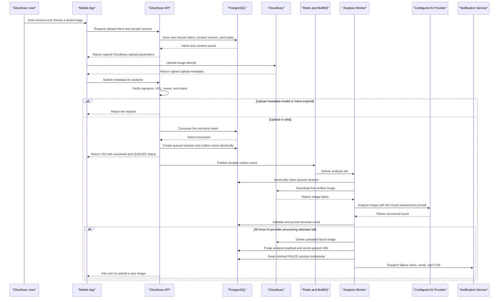

# Skin Analysis

## Purpose

Skin analysis returns a cosmetic visual estimate of skin characteristics
visible in a user's facial image. It is not a medical diagnosis or an
instrument measurement.

## Primary workflow

1. The client calls `GET /skin-analysis/consent-info`, displays its disclosure
   for Cloudinary and the active AI provider (Groq by default), and obtains
   consent before upload. It sends `{ "consentAccepted": true }` to
   `POST /skin-analysis/upload-intent`; the server stores the consent version
   against that user-bound intent before issuing a signature.
2. The client uploads the image directly to Cloudinary.
3. The client calls `POST /skin-analysis/analyze` with the Cloudinary upload
   metadata.
4. The backend verifies the Cloudinary response and consumes the matching,
   unexpired `SKIN_ANALYSIS` intent.
5. The backend persists a `QUEUED` analysis session and a transactional outbox
   event in one PostgreSQL transaction, then returns `202 Accepted` with the
   `sessionId` and `QUEUED` status.
6. The outbox dispatcher publishes the event to BullMQ. A Redis outage leaves
   the durable event pending for a later dispatcher pass.
7. The worker atomically changes the owned session from `QUEUED` to `RUNNING`,
   downloads the verified Cloudinary image, then invokes the configured AI
   provider.
8. The worker validates the response and transactionally persists the result
   and observations before changing the session to `SUCCEEDED`.
9. A failed worker attempt returns the session to `QUEUED`; BullMQ performs
   three total processing attempts, with one AI-provider request per attempt.
   After the third failure, up to three additional queue attempts are reserved
   only for cleanup; they never call the AI provider again. Once cleanup succeeds, the worker
   deletes the Cloudinary image, purges analysis outputs and the outbox URL,
   retains a minimal `FAILED` session record, then sends inbox, email, and FCM
   notifications asking for a new image.

The app polls `GET /skin-analysis/:sessionId` until the session is terminal.
BullMQ may deliver a job more than once, so only the worker that atomically
claims `QUEUED` may call the configured AI provider; a duplicate delivery exits without a provider
call. A `RUNNING` lease older than the configured reclaim period may be claimed
again after a worker crash.

## Result returned to the client

Results are entitlement-aware. A Free `USER` can submit analysis and read the
quality outcome plus overall status summary (`overallSkinScore`, confidence,
and notes), but detailed profile, metric, region, observation, and highlight
data is withheld. The result includes `premiumRequired: true` to explain the
locked detail. An active Premium package or the `ADMIN` role permits the full
validated result. Recommendations and routine endpoints require their mapped
Premium permissions and otherwise return `403 PREMIUM_REQUIRED`.

The structured result includes:

- Image quality acceptance and issue codes.
- An overall visible-skin score and explanatory notes.
- A visual skin-type estimate and notes. Sensitivity is always returned as
  `null`, because one image cannot establish skin sensitivity.
- Scores, confidence, and visibility for acne, redness, dark spots, pores,
  dryness, oiliness, and uneven texture.
- Scores, confidence, and visibility for forehead, left cheek, right cheek,
  nose, and chin.
- Observations with severity and normalized bounding boxes, plus highlights
  with normalized coordinates that the client can draw over the original
  image.
- Limitations of the estimate.

If the configured AI provider returns a structurally valid result with `quality.accepted` set to
`false`, the worker still persists that result. The quality flag and issue
codes are part of the session result for the client to interpret.

## Business rules and limitations

- Cloudinary metadata must prove the image was uploaded for this user under a
  valid skin-analysis intent. The backend does not analyze an arbitrary URL
  supplied by the client.
- The upload intent is consumed before downloading the image and calling the
  configured AI provider. If download, analysis, or result validation fails, the same intent
  cannot be reused; the client must create another intent and upload again.
- The prompt directs the configured model to assess visible appearance only, avoid
  identifying the person or inferring protected/personal characteristics, and
  avoid medical claims. Scores are estimates based on a single image.
- Consent is required before a signed upload intent is issued and is stored
  with the upload intent and analysis session. The version records which notice
  the client should display; the backend cannot prove what text the client
  showed. Consent version `skin-analysis-consent-v3` identifies the active
  provider returned by the upload-intent endpoint. The notice must say the
  facial image is uploaded to Cloudinary and shared with that provider for a
  cosmetic visual estimate, not a medical diagnosis. Groq is the default;
  OpenAI and Gemini can be selected with server configuration.
- The worker stores session state, validated result, and observations. It does
  not log image bytes, image URLs, or raw provider responses.
- The upload intent remains in `app_cloudinary.upload_intents`; Cloudinary owns
  the image while PostgreSQL owns the analysis history and durable job intent.
- After three processing attempts fail, the source image and facial-analysis
  outputs are purged. A minimal failed session tombstone (owner, status,
  normalized error code, timestamps, and attempt count) remains for history and
  support; upload-intent consent evidence is retained as a minimal audit record.
- Cloudinary deletion is attempted up to three cleanup queue attempts. If the provider remains
  unavailable or database cleanup fails, terminal cleanup needs operational
  reconciliation; delivery is best-effort and should be monitored.
- User-requested deletion and account-deletion cascades across Cloudinary,
  PostgreSQL, queued jobs, and derived recommendation data still need a
  dedicated workflow.
- AI analysis is not yet connected to persisted routine generation. The
  recommendation feature currently uses validated metrics for catalog matching
  only; see [Recommendations](./Recommendation.md).

## Business Workflow Sequence

<!-- mermaid-checked: every participant uses `participant Id as "Label"`, no \n in aliases/messages/notes, every alt/opt/loop closed by end, no `:` inside any alias -->

