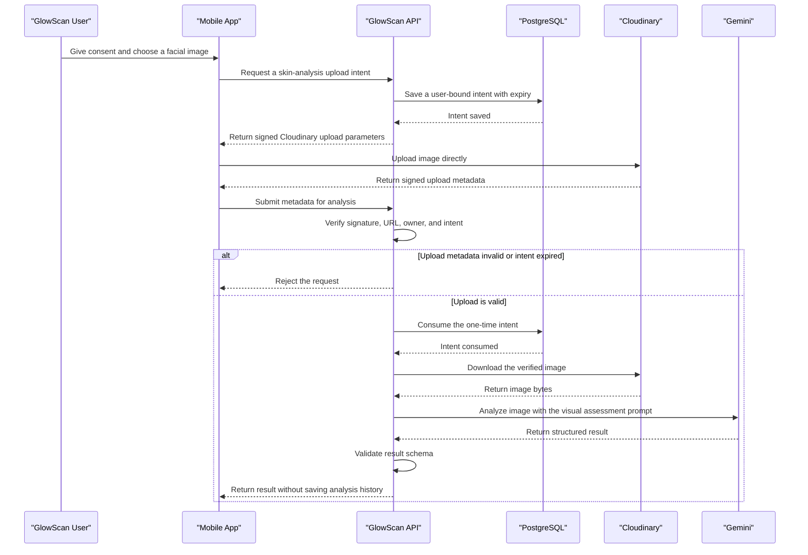

# Skin Analysis

## Purpose

Skin analysis returns a cosmetic visual estimate of skin characteristics
visible in a user's facial image. It is not a medical diagnosis or an
instrument measurement.

## Primary workflow

1. The client obtains the user's consent before uploading or analyzing a facial
   image, then requests a user-bound upload intent from
   `POST /skin-analysis/upload-intent`.
2. The client uploads the image directly to Cloudinary.
3. The client calls `POST /skin-analysis/analyze` with the Cloudinary upload
   metadata.
4. The backend verifies the Cloudinary response and consumes the matching,
   unexpired `SKIN_ANALYSIS` intent.
5. The backend downloads the verified Cloudinary image. It rejects failed
   downloads, redirects, empty images, unsupported content types, and images
   larger than 10 MB. JPEG, PNG, and WebP are supported.
6. The backend sends the image and analysis prompt to Gemini.
7. The backend parses and validates the returned JSON against the skin-analysis
   result contract. A malformed response is rejected; a valid response is
   returned to the client.

The request is processed synchronously. The backend does not create an
analysis job or queue work for later processing.

## Result returned to the client

The structured result includes:

- Image quality acceptance and issue codes.
- An overall visible-skin score and explanatory notes.
- A visual skin-type estimate and notes. Sensitivity is always returned as
  `null`, because one image cannot establish skin sensitivity.
- Scores, confidence, and visibility for acne, redness, dark spots, pores,
  dryness, oiliness, and uneven texture.
- Scores, confidence, and visibility for forehead, left cheek, right cheek,
  nose, and chin.
- Observations with severity and normalized bounding boxes, plus highlights
  with normalized coordinates that the client can draw over the original
  image.
- Limitations of the estimate.

If Gemini returns a structurally valid result with `quality.accepted` set to
`false`, the backend still returns that result. The quality flag and issue
codes are part of the response for the client to interpret.

## Business rules and limitations

- Cloudinary metadata must prove the image was uploaded for this user under a
  valid skin-analysis intent. The backend does not analyze an arbitrary URL
  supplied by the client.
- The upload intent is consumed before downloading the image and calling
  Gemini. If download, analysis, or result validation fails, the same intent
  cannot be reused; the client must create another intent and upload again.
- The prompt directs Gemini to assess visible appearance only, avoid
  identifying the person or inferring protected/personal characteristics, and
  avoid medical claims. Scores are estimates based on a single image.
- Consent is expected from the client before upload. The current API flow does
  not collect or persist a consent record.
- Analysis is not saved. No analysis session, analysis image, assessment
  snapshot, result, observation, or outbox record is created by the current
  service. The `app_skin_analysis` tables created by the database migration are
  schema groundwork for a future persistence workflow, not evidence that
  history is currently stored.
- The upload intent is the only related database record in the current flow;
  it is stored in `app_cloudinary.upload_intents`. The image itself is stored
  in Cloudinary, and the analysis result exists only in the response unless
  the client stores it separately.

## Business Workflow Sequence

<!-- mermaid-checked: every participant uses `participant Id as "Label"`, no \n in aliases/messages/notes, every alt/opt/loop closed by end, no `:` inside any alias -->

