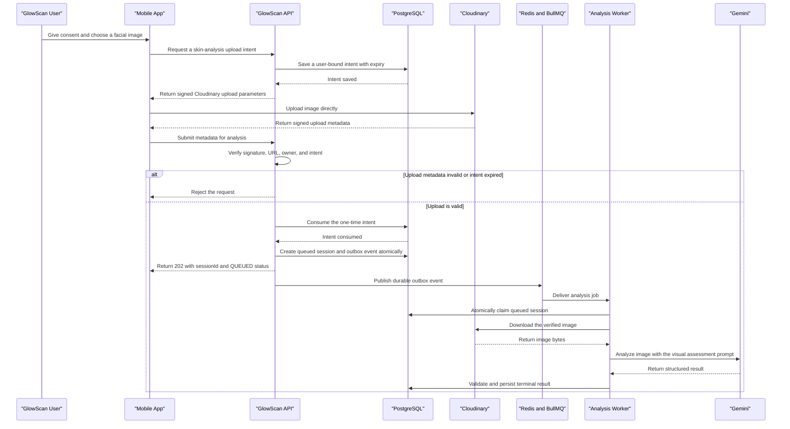

# Skin Analysis

## Purpose

Skin analysis returns a cosmetic visual estimate of skin characteristics
visible in a user's facial image. It is not a medical diagnosis or an
instrument measurement.

## Primary workflow

1. The client obtains the user's consent before uploading or analyzing a facial
   image, then requests a user-bound upload intent from
   `POST /skin-analysis/upload-intent`.
2. The client uploads the image directly to Cloudinary.
3. The client calls `POST /skin-analysis/analyze` with the Cloudinary upload
   metadata.
4. The backend verifies the Cloudinary response and consumes the matching,
   unexpired `SKIN_ANALYSIS` intent.
5. The backend persists a `QUEUED` analysis session and a transactional outbox
   event in one PostgreSQL transaction, then returns `202 Accepted` with the
   `sessionId` and `QUEUED` status.
6. The outbox dispatcher publishes the event to BullMQ. A Redis outage leaves
   the durable event pending for a later dispatcher pass.
7. The worker atomically changes the owned session from `QUEUED` to `RUNNING`,
   downloads the verified Cloudinary image, then invokes Gemini.
8. The worker validates the response and transactionally persists the result
   and observations before changing the session to `SUCCEEDED`; errors produce
   a normalized `FAILED` session state.

The app polls `GET /skin-analysis/:sessionId` until the session is terminal.
BullMQ may deliver a job more than once, so only the worker that atomically
claims `QUEUED` may call Gemini; a duplicate delivery exits without a provider
call. A `RUNNING` lease older than the configured reclaim period may be claimed
again after a worker crash.

## Result returned to the client

The structured result includes:

- Image quality acceptance and issue codes.
- An overall visible-skin score and explanatory notes.
- A visual skin-type estimate and notes. Sensitivity is always returned as
  `null`, because one image cannot establish skin sensitivity.
- Scores, confidence, and visibility for acne, redness, dark spots, pores,
  dryness, oiliness, and uneven texture.
- Scores, confidence, and visibility for forehead, left cheek, right cheek,
  nose, and chin.
- Observations with severity and normalized bounding boxes, plus highlights
  with normalized coordinates that the client can draw over the original
  image.
- Limitations of the estimate.

If Gemini returns a structurally valid result with `quality.accepted` set to
`false`, the worker still persists that result. The quality flag and issue
codes are part of the session result for the client to interpret.

## Business rules and limitations

- Cloudinary metadata must prove the image was uploaded for this user under a
  valid skin-analysis intent. The backend does not analyze an arbitrary URL
  supplied by the client.
- The upload intent is consumed before downloading the image and calling
  Gemini. If download, analysis, or result validation fails, the same intent
  cannot be reused; the client must create another intent and upload again.
- The prompt directs Gemini to assess visible appearance only, avoid
  identifying the person or inferring protected/personal characteristics, and
  avoid medical claims. Scores are estimates based on a single image.
- Consent is expected from the client before upload. The current API flow does
  not collect or persist a consent record.
- The worker stores session state, validated result, and observations. It does
  not log image bytes, image URLs, or raw provider responses.
- The upload intent remains in `app_cloudinary.upload_intents`; Cloudinary owns
  the image while PostgreSQL owns the analysis history and durable job intent.

## Business Workflow Sequence

<!-- mermaid-checked: every participant uses `participant Id as "Label"`, no \n in aliases/messages/notes, every alt/opt/loop closed by end, no `:` inside any alias -->

